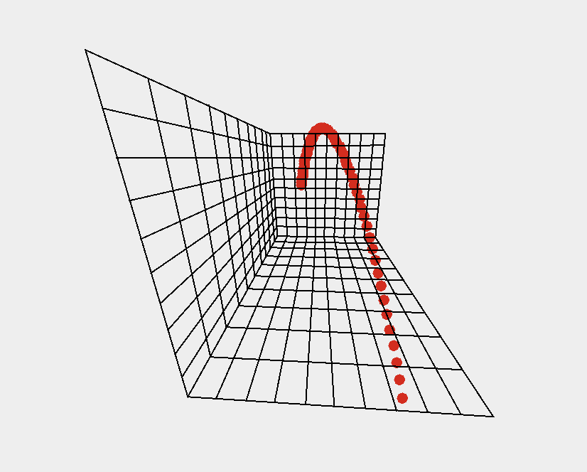

# Baseball Hit-Trax
Made for my AP CS final project with @monpon and @coolmath2018

Three part project: 
1. **Track Baseball through OpenCV**
   1. Uses background subtraction to detect moving objects, then applies HSV color masking to filter for light/white regions—reducing noise and isolating the target ball from the background.
   2. Use Gaussian blur and Hough Circle Transform to detect circular objects each frame
   3. Computes frame-to-frame deltas to estimate ball velocity

2. **Calculate the ball's projected path**
   1. Parses motion data from vision output 
   2. Apply basic projectile motion physics to model the ball’s flight path.
   3. Produces a bounded, scaled set of 3D coordinates representing the predicted trajectory.

3. **Graph the ball and its path on a 3D GUI** - we decided to do this part by scratch. 
   1. We built a 3D camera projection engine that transforms 3D trajectory points and lines into 2D screen coordinates, simulating how a real camera views the ball in space.
   2. Renders the projected ball path and coordinate axes in a Swing GUI, allowing real-time camera rotation and translation
   3. Projects vectors frame-by-frame for intuitive understanding of the ball’s motion.
